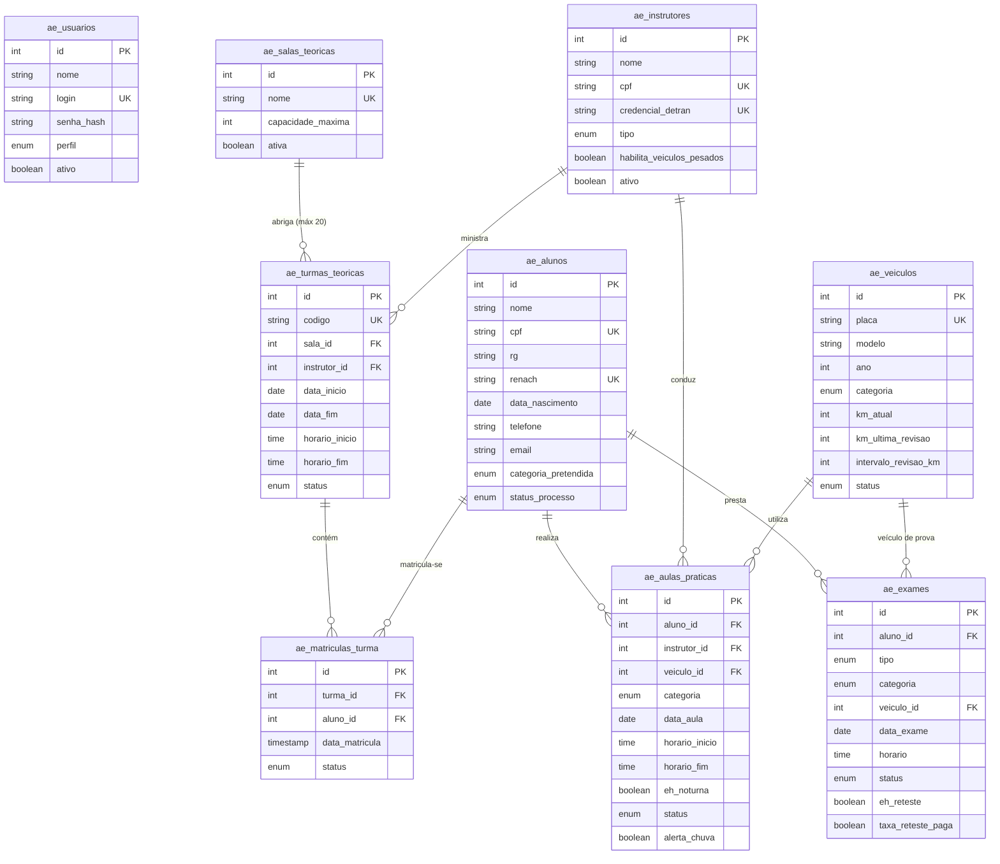

# 🗄️ Modelo Entidade-Relacionamento (DER) - MySQL
### Sistema de Gestão de Autoescola
**Autor:** Agente Especialista em Banco de Dados (`database_mysql`)  
**Scripts:** [database/schema.sql](file:///C:/Users/bsant/Downloads/Auto-Escola-main/database/schema.sql) | [database/seeds.sql](file:///C:/Users/bsant/Downloads/Auto-Escola-main/database/seeds.sql) | [database/banco-completo.sql](file:///C:/Users/bsant/Downloads/Auto-Escola-main/database/banco-completo.sql) | [scripts/setup-db.js](file:///C:/Users/bsant/Downloads/Auto-Escola-main/scripts/setup-db.js)

> [!IMPORTANT]
> **Isolamento de Banco Compartilhado:** Todas as tabelas deste projeto utilizam estritamente o prefixo **`ae_`** para garantir que outras tabelas de outros projetos escolares coexistindo na mesma base de dados não sofram interferência ou perda acidental.

---

## 📊 Diagrama ER (Mermaid) - Tabelas com Prefixo `ae_`

---

## 🔒 Mecanismos de Prevenção de Conflitos e Integridade
1. **Trigger `trg_ae_valida_capacidade_turma`:** Bloqueia automaticamente a inserção de mais de 20 alunos por turma na sala teórica.
2. **Índices Compostos de Concorrência:**
   - Prevenção de sobreposição de instrutor em horários idênticos (`idx_ae_pratica_instrutor_horario`).
   - Prevenção de alocação dupla de veículos no mesmo horário (`idx_ae_pratica_veiculo_horario`).
   - Prevenção de marcação simultânea para o mesmo aluno (`idx_ae_pratica_aluno_horario`).
3. **Auditoria e Histórico:**
   - Tabelas `ae_manutencoes_veiculo` para histórico de revisões e `ae_notificacoes_fila` para mensageria com 1 dia de antecedência.
